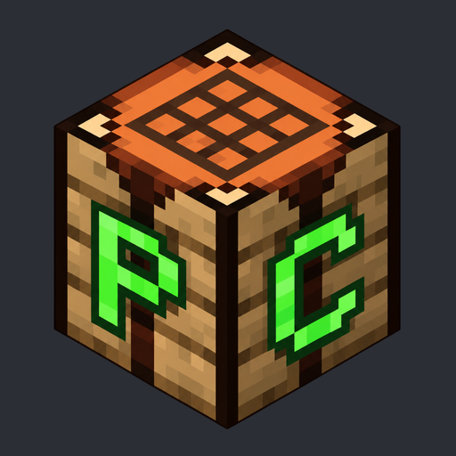

  

  <a href="#downloads">Downloads</a> ·
  <a href="#current-status">Current status</a> ·
  <a href="#roadmap">Roadmap</a> ·
  <a href="CHANGELOG.md">Changelog</a>

# ProsperoCraft

**A native PlayStation 5 port of Minecraft Java Edition — no Wine.**

The original Minecraft Java code runs on our PS5-native OpenJDK 25 port, with
native PS5 graphics, audio and input integration. There is no Windows build or
Wine compatibility layer involved.

ProsperoCraft brings Java Edition worlds, servers and the modding ecosystem to
PS5 homebrew. The goal is a polished client with responsive controls, smooth
rendering, working sound, reliable saves and an easy-to-use launcher.

> **Sound works and gameplay feels buttery smooth on PS5.** The latest
> **01.000.074** playtest confirms both, with native Java 25 and G1 GC.
> [Playtest evidence](docs/validation/client074-smooth-audio-confirmation-2026-10-26.json) ·
> [Download the native launcher083 →](https://github.com/mateo-cogeanu/ProsperoCraft/releases/tag/01.000.083)

## Downloads

| Release | What to expect | Get started |
| :--- | :--- | :--- |
| **Native launcher · 01.000.083** | Download26.3demo instances on the console. Fixed1080p logical/display size addresses reported click misalignment; exact083PS5confirmation pending. | [Download](https://github.com/mateo-cogeanu/ProsperoCraft/releases/tag/01.000.083) · [Setup](docs/releases/client-resolution-083.md) |
| **Fabric / Paper servers · 01.000.108** | Separate server builds with positive console playtests. Full lifecycle and endurance checks remain pending. | [Download](https://github.com/mateo-cogeanu/ProsperoCraft/releases/tag/Fabric-Paper-v01.000.108) · [Setup](docs/releases/fabric-paper-108.md) |

Follow the matching release's provisioning instructions to obtain and verify the
official game files. Public app-only downloads exclude Minecraft JARs and game
asset objects; matching source, checksums and licensing details accompany each
release.

The client and server share title ID **PPSA99874**: installing one replaces the
other. Keep your world backups and the matching server package for reinstalling.

## Current status

| Area | Status |
| :--- | :--- |
| **Native Java 25** | Runs on PS5, with guarded C1 compilation used by the playable client. |
| **Client gameplay** | The user reports buttery-smooth gameplay on exact build074. FPS has not been benchmarked. |
| **Controls** | Temporary DualSense keyboard/mouse mapping works. Full Controlify integration is planned. |
| **Sound** | The user confirms very good game sound on exact build074. |
| **Validation ahead** | Save/reload, controller polish, measured frame pacing and extended play remain to be checked. |

Release083 requests 4 GiB of app storage for the redesigned native launcher,
persistent instance library, controller navigation and verified on-console demo downloads. New installs start
empty; no game JARs or assets are bundled. [Preview and setup](docs/client-instances-079.md) · [Storage update](docs/client-storage-080.md) · [Controls and launcher polish](docs/client-controls-081.md) · [Checkbox, stick navigation and quit lifecycle](docs/client-launcher-082.md).
082 adds a compact saved checkbox, native left-stick navigation and bounded focus animation.
The user confirms all082fixes work on PS5, including quit → launcher → relaunch.
[Scoped console confirmation and frozen snapshot](Client_Launcher_Lifecycle/README.md).
26.3is the gameplay baseline;26.1/26.2need a separate GLFW native path.
Microsoft account access remains blocked at Minecraft Services403pending app review.
[Development084](docs/client-offline-084.md) adds a separate offline single-player
test using a locally verified ownership/profile record; no login tokens are
transferred. Exact084PS5validation remains pending. This is not app approval or
a public account-import service.

Development074 now has positive PS5 sound and smoothness feedback, with no active quality caps.
See the [freeze investigation and candidate guide](docs/client-audio-pacing-074.md).
Release082 retains that implementation; the074playtest does not establish an082regression pass. Earlier066 remains available as a checkpoint.
For individual fixes, console evidence and earlier milestones, read the detailed
**[CHANGELOG.md](CHANGELOG.md)**.

## Roadmap

### Required for store release

- [ ] **Microsoft login** for official downloads.
- [ ] **Launcher menu with instances**, full settings and instance management.
- [ ] **All Minecraft 26.x releases**, including snapshots.
- [ ] **Fabric, Forge and NeoForge instances** within the current 26.x releases.
- [ ] **SDL3 support for Controlify** integration.
- [ ] **Performance good enough for shaders.**

These are planned release requirements. Loader, mod and shader compatibility
will need validation for each supported game version.

### Later

- [ ] **Custom menu music by CogiArt.**
- [ ] **`.mrpack` imports.**
- [ ] **USB keyboard and mouse controls.**
- [ ] **Themes.**
- [ ] **JVM 21** for broader Minecraft support.
- [ ] **JVM 17** for even broader Minecraft support.

## Resolution follow-up

A Store-installed082report identifies misaligned game-menu clicks when using
lower logical resolutions. On082, select1920×1080in launcher Settings before
launching. [Development083](docs/client-resolution-083.md) locks1080pin launch,
SDLwindow and display selection and migrates saved settings. Its exactPS5
pointer/demo-world check remains pending. [Release083](docs/releases/client-resolution-083.md)
is published at the user’s request; the Store catalog update follows separately.
The published082package remains unchanged as a fallback.

## Runtime foundation

ProsperoCraft is powered by the separate
**[PS5 Java 25 runtime project](https://github.com/mateo-cogeanu/ps5-java25-homebrew)**.
That repository maintains OpenJDK, PS5 platform adaptations and reusable runtime
tools. This repository maintains Minecraft integration, artifact pins, native
dependencies, launch configuration, controls and game-specific validation.

Official game JARs and assets stay intact in current development. Frozen historical
workarounds and their migration history are documented in the changelog.

## License and fork credit

ProsperoCraft's original code is licensed under **GNU GPL v3.0 or later**
([LICENSE](LICENSE), SPDX: `GPL-3.0-or-later`).

**Copyright (C) 2026 mateo-cogeanu — ProsperoCraft.** Distributed forks must
preserve applicable copyright and license notices, identify their changes and
provide corresponding source under the GPL as required. Keep ProsperoCraft's
original copyright credit when redistributing its covered code.
See [NOTICE](NOTICE) for the project attribution and upstream credits.

This requires preserving legal credit; it does not add a mandatory advertising
or splash-screen credit. Upstream components retain their own licenses and
exceptions. Official Minecraft files and third-party trademarks are not
relicensed by this project's grant. The published082binary remains unchanged;
its release also supplies the project license and attribution notice separately.

## Follow the project

- **[Releases](https://github.com/mateo-cogeanu/ProsperoCraft/releases)** — downloads, setup and checksums.
- **[Detailed changelog](CHANGELOG.md)** — build-by-build changes, results and known issues.
- **[Milestone archive](CHANGELOG.md#milestones--releases)** — frozen source snapshots and console validation.
- **[Java runtime](https://github.com/mateo-cogeanu/ps5-java25-homebrew)** — the native Java foundation.
- **[Project artwork](assets/branding/README.md)** — branding and graphics.

ProsperoCraft is an independent homebrew project, unaffiliated with Mojang,
Microsoft or Sony.
