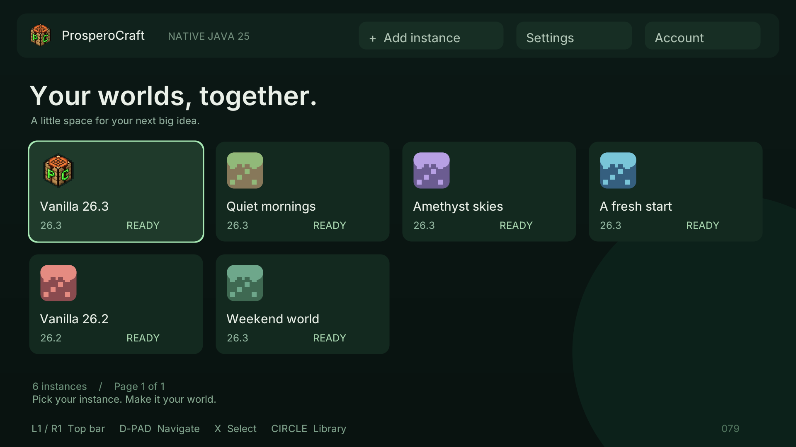
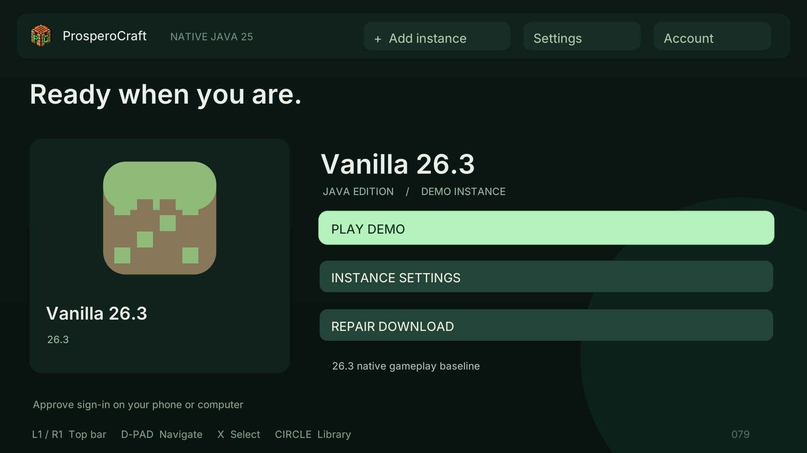
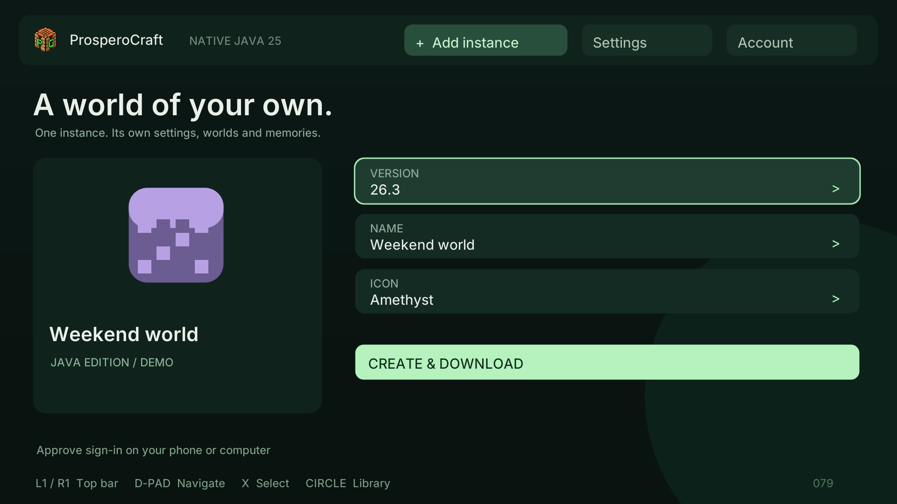
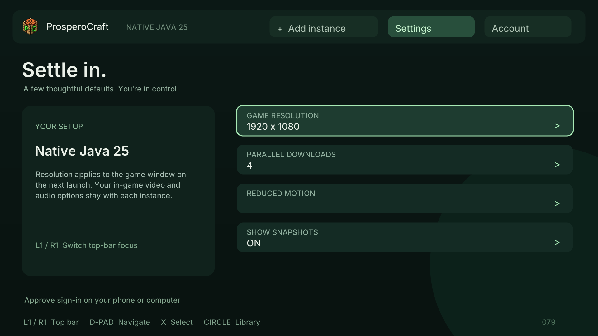

# ProsperoCraft library — candidate079

This is a host render of the actual native drawing code with example data.
**A new installation starts empty.** The app does not include Minecraft client
JARs or asset objects. Existing078and earlier packages remain preserved.

## Controller navigation

The top bar has **Add instance**, **Settings**, and **Account**. L1/R1 changes its
focus; X opens the selected panel. D-pad navigates instance tiles and controls;
Circle returns to the library or cancels a task. Holding a direction repeats after
a short delay. Selection glow and short page transitions settle rather than
animating continuously while idle. Reduced Motion is available in Settings.

Select an instance tile to open a large icon on the left and Play, Instance
Settings and Repair Download on the right.

## Add an instance

1. Open Add instance with L1/R1 and X, or press X in an empty library.
2. Choose a26.x release with left/right or X on the Version row. Settings can also
   expose snapshots. Catalog retrieval has an offline fallback after a successful
   fetch; creating a new download still requires the publisher files.
3. Select Name to use the controller keyboard. D-pad moves, X adds a character,
   Triangle deletes, L2 switches case, R2 adds a space, Options clears, Square
   confirms, and Circle cancels. Names are limited to40supported characters.
4. Choose one of eight built-in icons. Custom PNG import is not implemented.
5. Select Create & Download. The instance appears immediately while installation
   proceeds. Download progress and completed/total MB appear in the footer.

The official version manifest determines the selected version's original client,
Java libraries and asset index. Downloads verify publisher SHA-1 and size before
committing a file, use HTTPS with certificate and hostname validation, reject
redirects/untrusted domains and traversal paths, and bound transfer concurrency.
Desktop native classifiers are excluded; the PS5native bindings are shipped with
the app. No game JAR is transformed. Minecraft's ordinary client files implement
its demo; there is no separate demo JAR to download.

Verified immutable files are shared by version. Each instance has its own game
folder, saves, resource packs, options and native-cache directory. Renaming or
changing its icon does not move or alter its worlds. Metadata uses UUID directory
names and a staged JSON save with a previous-file backup. New default names avoid
existing names; editing the name keeps it when changing version.

Circle cancels a transfer and waits for active workers to stop before allowing
another transfer. Verified cache files are retained, partial files removed; retry
or Repair Download reuses verified files. Interrupted installs are not marked
ready. The app never deletes instance worlds as part of download/repair.

## Settings and account

Game resolution requests1280x720,1600x900or1920x1080on the next launch. It does not
change the console's physical output mode; actual PS5 behavior needs testing.
Download concurrency1–6, Reduced Motion and snapshot visibility are persistent.
Each game's ordinary video/audio options remain in that instance's own folder.

The account panel retains Microsoft phone/device-code sign-in and redacted stage/
HTTP errors. Minecraft Services currently rejects our application ID with403;
application review is pending. No other application's ID or entitlement bypass
is used. This candidate launches instances with the original **--demo**, with
multiplayer/chat disabled, regardless of account state, as requested for now.
Full account login and full-game launch remain separate future validation.

## Version compatibility matters

Publisher metadata confirms26.1,26.2and26.3use Java25. The installer can obtain
26.x releases and snapshots with Java25, using their own exact files and index.
**That does not prove every26.xversion runs on PS5.** 26.1/26.2use GLFW3.4.1;
the existing PS5window port is SDL3/LWJGL3.4.3used by26.3. The GLFW native path
is not implemented.26.2can be selected/downloaded, but gameplay is not currently
supported by those bindings. No26.3JAR is substituted for an older selection.
Start console testing with26.3. Other versions require native compatibility work
and exact-version console tests; do not advertise all26.xgameplay support.

## Storage and validation

Runtime data is under `/download0/ProsperoCraft/`:

| Path | Purpose |
| --- | --- |
| `library.json`, `library.json.backup` | Instance metadata and launcher settings |
| `instances/<uuid>/game/` | Isolated worlds and options |
| `cache/versions/<version>/` | Original client, metadata and verified install receipt |
| `cache/libraries/` | Publisher Java libraries |
| `cache/assets/` | Per-version indexes and shared original objects |

Old `/download0/mc-client` data is preserved;079does not silently import or change
it. No removal/archive or custom icon import is implemented yet.

Host tests exercise empty/reopened libraries, separate worlds, rename/icon/settings,
L1/R1and keyboard/controller install/play, correct26.2/index32/demo arguments,
traversal/URL/classifier rejection, checksums, cache reuse, repair, cancellation
and failed-install handling. A real26.3publisher-data test runs the actual installer
against verified local input and checks54originalJARs/5147assets/index34plus the
isolated game loader and parent native bindings. Native scenes and the JNI mailbox
are tested with host fixtures. These are not PS5download/gameplay/frame-rate tests.

[Exact build record](validation/client079-instances-build-2026-10-26.json).
