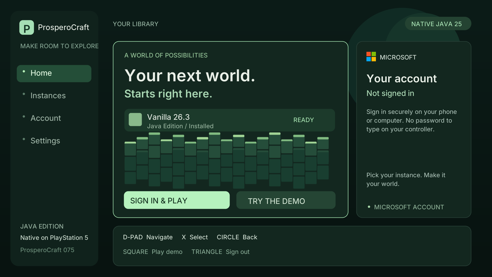
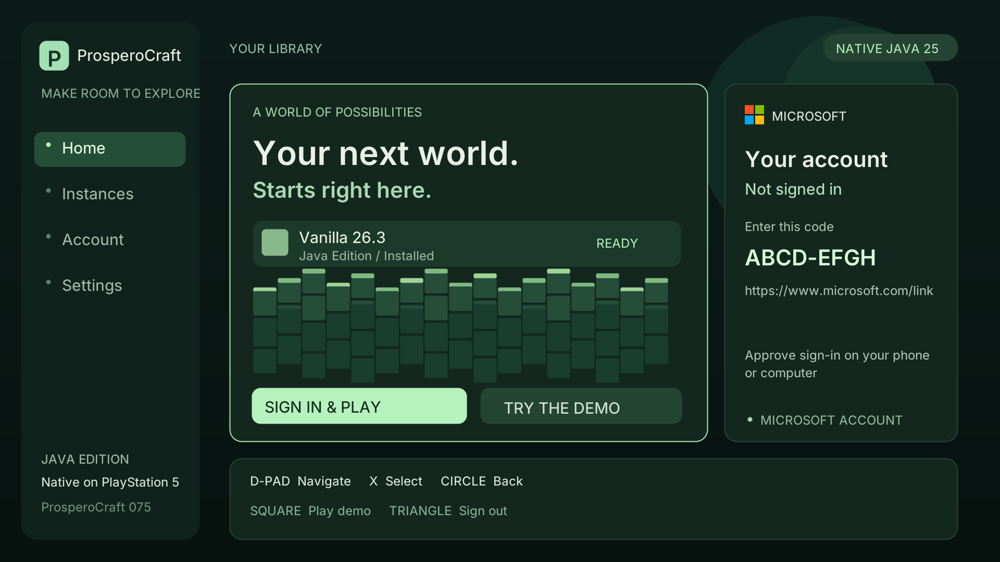

# Native launcher — candidate075

The preview above is rendered from the actual native draw code on a host fixture.
The sign-in preview below uses a fictional code, not a live authorization request.

## Test on PS5

Install the local `dist/client-startup/PPSA99874.zip`, title **PPSA99874**, version
**01.000.075**. Installing it replaces the other client/server with the same title.
The working074 package remains preserved in `dist/accepted/Client_Smooth_Audio-01.000.074`.

The app prepares Java and opens the launcher directly. Use D-pad up/down to select
Home, Instances, Account, Settings or Demo; X selects. Home starts sign-in when
signed out, then starts Minecraft when signed in. Square launches the demo.
Circle cancels sign-in; Triangle signs out. The first version has one installed
Vanilla26.3 instance and a read-only settings summary. Instance creation, mod
loaders and editable launcher settings are future work.

Select **Sign in & Play**, then visit the Microsoft URL shown on your phone or
computer and enter the displayed code. Approve the ProsperoCraft sign-in yourself.
After the account name appears, press X on Home to play. Do not share the live
code or account tokens. Microsoft passwords are entered only on Microsoft's site.
Sign-in must be repeated after restarting the app; tokens are kept only in memory.

First verify that the launcher appears and responds, then try Square for a demo
handoff. Also test account login and Home/Play. Confirm game audio, controls and
world performance still work. If sign-in fails, report the on-screen message;
never send account tokens. A Minecraft Services registration/approval error needs
separate service-side investigation; host tests do not establish approval.

## Implementation and checks

Public app ID: `f0c7635e-8d50-4d7e-afa3-d15db4a0a3d3`. Personal Microsoft accounts
use the consumers authority and public-client device-code flow. In the application
registration, enable **Authentication → Advanced settings → Allow public client
flows**. No client secret is used. The checked-in public configuration is
`client/launcher/auth-config.json`; the Java implementation carries the matching ID.
[Microsoft's device-code protocol](https://learn.microsoft.com/en-us/entra/identity-platform/v2-oauth2-device-code).

Auth polls with expiry, cancellation and slowdown handling, then exchanges Xbox
and XSTS tokens, checks a Minecraft Java entitlement and validates the profile.
Only fixed HTTPS service endpoints are used; TLS validation remains enabled and
redirects are refused. Raw responses, device secrets and tokens are excluded from
diagnostics. Host tests use scripted responses, not a real account.

The native menu redraws only when its state changes. The returning runtime UI
closes VideoOut before releasing mapped display buffers; failed cleanup prevents
launch. The original game Main receives either the explicitly selected demo args
or the authenticated profile/session. Original game JARs/assets are unchanged.
074's early audio init, C1, G1/1536MiB and existing video settings are retained.

Host auth, UI rendering/cleanup fault injection, startup and policy tests pass.
Target compile/link/SELF/package and original artifact checks pass. **PS5 menu,
live sign-in and display handoff remain unvalidated.** Save/reload and extended
play remain separate checks. The public playable release is still066.

[Exact build record](validation/client075-launcher-build-2026-10-26.json).
