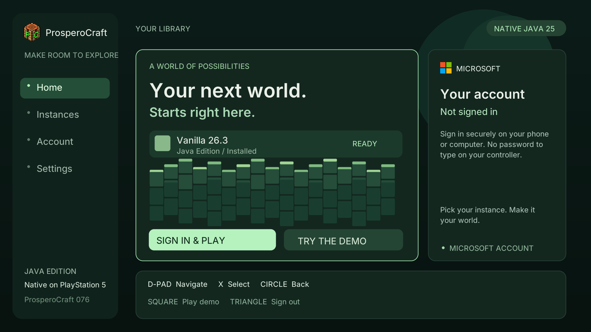

# Launcher branding — candidate076

Uses the supplied ProsperoCraft2.png for the PS5 app icon and the supplied
ProsperoCraftTransparent.png for the launcher corner. This image is a host render
of the actual native UI, not a PS5 screenshot.

Install local `dist/client-startup/PPSA99874.zip`, titlePPSA99874/version01.000.076,
after finishing the075MSA test. The exact075test package remains preserved at
`dist/accepted/Client_Launcher-01.000.075/PPSA99874-full-local.zip`.

Controls and login behavior follow the [075guide](client-launcher-075.md).
MSA implementation, game JARs, assets and074audio/performance settings are unchanged.
No console appearance or login pass is inferred from host verification.

Artwork sources and checksums are tracked in `assets/branding/branding.json`.
`tools/prepare_launcher_branding.py` reproducibly resizes the512x512 app icon and
bakes the72x72 native logo. The source transparency is composited against the
constant native sidebar color; fully transparent pixels are skipped.

[Build record](validation/client076-branding-build-2026-10-26.json).
