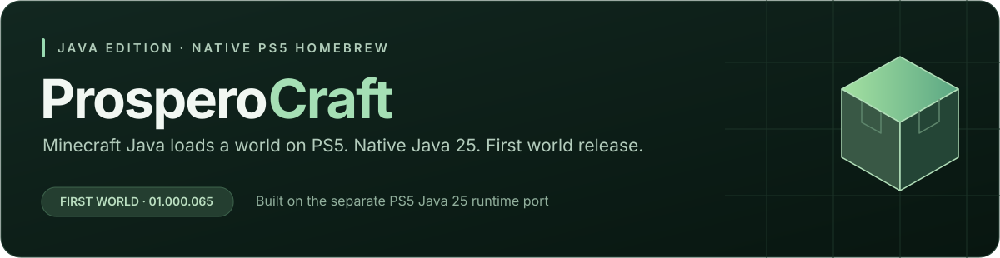

# ProsperoCraft — first Minecraft Java world on PS5



**The world loaded. Punching works. Performance is the next challenge.**

The user confirmed world entry in **01.000.065** on 26 October 2026. This full
GitHub release preserves that exact native Java 25 build. It is an experimental
world-entry checkpoint: **severe lag, very long loading and inability to move
remain known issues**. It is not a playable-performance or full-client ALL PASS.

[GitHub release](https://github.com/mateo-cogeanu/ProsperoCraft/releases/tag/Client_World-v01.000.065) ·
[Human confirmation](../validation/client065-world-confirmation-2026-10-26.json) ·
[Hashed report analysis](../validation/client065-world-reports-2026-10-26.json).

## What's here

The original Minecraft 26.3 client reaches a world using native Java 25,
resident SDL3 input, RADV/Vulkan rendering and the existing native dependency
ports. Temporary menu controls work; the user could punch in-world. All 54
original game/dependency JARs and 5,147 asset objects remain unmodified.

065 fixes the heap reservation failure encountered in064. The Java port can
reserve a separately bounded direct-memory heap with compressed object pointers
explicitly disabled. The 512 MiB heap initializes on PS5, commits pages and runs GC.
It preserves separate native/metadata budget limits and safe ownership/zeroing.
The game still uses the interpreter (`-Xint`), SerialGC and diagnostic logging.
No hardware-utilization, frame-rate, movement or stability claim is made.

World-entry reports show the player joining and actual world rendering, with
repeated integrated-server overload warnings. This release deliberately retains
those tested bytes. Movement, camera, useful frame rate, repeated load/save/reload,
full teardown and long-duration stability need further work. **PS5 speaker audio
is not implemented**; the current OpenAL port supplies null/loopback backends.
The next development candidate will investigate guarded C1 compilation and input
capture. It does not change this release's acceptance.

## Setup

Use a PS5 able to run this project's homebrew app format and your normal
homebrew launcher/installer. On your desktop, use Python3.11 or newer and sufficient
space for a download cache plus the reconstructed app. Use your legitimate
Minecraft installation/entitlement. The harness launches the supported offline
demo path, with multiplayer/chat disabled and no account-credential collection.

Download `ProsperoCraft-01.000.065-world-app-only.zip`, `client065-install-manifest.json`,
`provision_client_menu.py`, `README-client065.md` and `SHA256SUMS`. The helper name
is retained for compatibility; it restores the complete world release too.
Compare each file's SHA256 with `SHA256SUMS`. macOS/Linux can run
`shasum -a 256 filename`; if all listed assets are downloaded, use
`shasum -a 256 -c SHA256SUMS`.

Extract the app ZIP to obtain `PPSA99874/`, then restore all excluded originals:

```sh
python3 provision_client_menu.py --manifest client065-install-manifest.json --app-dir PPSA99874 --cache-dir minecraft-originals --download
```

The helper downloads only from pinned publisher URLs and verifies every retained
and restored file plus the final inventory. Game JARs and asset objects are omitted
from the public ZIP. Provision it **before** installation. Existing verified files
can be supplied using `--jars-dir /path/to/build/client/jars --assets-dir /path/to/build/client-assets`.
A corrupt cache file is refused; remove that specific bad cached file and rerun.
The helper does not launch Minecraft or request credentials.

Copy/install the fully provisioned `PPSA99874` directory through your usual
homebrew workflow. If your installer expects a ZIP, zip that complete directory
with `PPSA99874/` at the root. Launch, press X once, and release it during loading.
Use D-pad/left stick for menu navigation, X to select, Circle to return,
Triangle for Tab and Square for Backspace. R2/L2 map to left/right mouse buttons.
In this release world movement/camera are known not to work as intended.
Expect very slow demo loading and severe lag. If it crashes, reopen without X
so the reports remain available; do not delete/reset worlds as a troubleshooting step.

**Shared title PPSA99874 replaces the installed server/client app.** Keep the
[Fabric/Paper server release](https://github.com/mateo-cogeanu/ProsperoCraft/releases/tag/Fabric-Paper-v01.000.108),
world backups and [062menu fallback](https://github.com/mateo-cogeanu/ProsperoCraft/releases/tag/Client_Menu-v01.000.062).
No Store submission or download-listing change is part of this release.

## Reproduction, checks and source

Tested consumer implementation `f7c1abb1502b1ef64b2413b75b78d6fcb93df1ae`;
runtime `44fdf26ccb74cf8dd9127f1256b85416856981de`. Release helpers/docs are added
without rebuilding the accepted app. Exact full local ZIP SHA256:

```text
a85c900937525c04cbae29c1a3f3018e3341e07f0ae6a85a14c733564ad3461a
```

That ZIP contains downloaded game files and remains local. The public app-only
ZIP has a different hash in `SHA256SUMS`. Reconstruction was compared against
every byte/file of the world-confirmed full app. Actual JAR/asset download,
corruption refusal and retained-file tampering checks passed.

`client065-openal-source-relink.zip` contains matching OpenAL 1.25.2 original and
modified sources, startup scope/header/getenv shim, exact native link objects,
build records, SDK headers and editable replacement instructions. Both unmodified
relinking and accepted-library replacement reproduce the accepted native ELF.
Edited/rebuilt apps do not inherit console acceptance. Read the kit's README.
OpenAL LGPL and all other bundled component notices remain in the app/source.
The runtime sources and all PS5 patches, including direct-heap 0118, are available
at [the matching Java port revision](https://github.com/mateo-cogeanu/ps5-java25-homebrew/tree/44fdf26ccb74cf8dd9127f1256b85416856981de).

The goal remains a polished, playable client: responsive controls, smooth rendering,
real audio, worlds, saving/reloading and stability. This release confirms that a
world loads; it does not establish that final experience. Server two-hour endurance
remains deferred.
